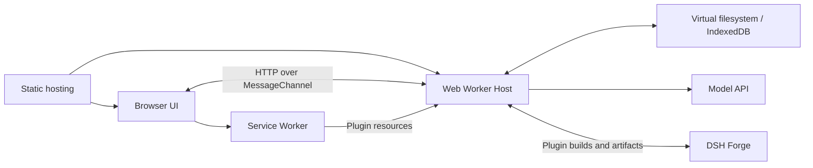

# DeepSeek Harness AIB

English | [中文](README.zh.md)

## Summary

**AIB — All in Browser** brings the DeepSeek Harness agent runtime into the browser. Run conversations and tools, work with virtual files, and build plugins that extend both the agent and its interface from one page.

The goal is to make the browser a workspace for using and extending an agent harness. The Host runs in a Web Worker, files live in a virtual filesystem, and the **dsh-aib** workbench manages source projects, plugin revisions and backups. Model inference uses external APIs; optional [DSH Forge](https://github.com/li-chx/dsh-aib-forge.git) builds plugin sources and prepares npm packages.

This is an independent, experimental [fork of DeepSeek Harness](https://github.com/deepseek-ai/deepseek-harness), developed upstream by DeepSeek AI. Browser compatibility and APIs are still evolving.

## Table of Contents

- [Why AIB?](#why-aib)
- [Demo and API key](#demo-and-api-key)
- [Project goals](#project-goals)
- [How it works](#how-it-works)
- [Run the browser preview](#run-the-browser-preview)
- [Current limitations](#current-limitations)
- [Development](#development)
- [Upstream and license](#upstream-and-license)

<a id="why-aib"></a>
## Why AIB?

Moving an agent harness and its capabilities into the browser inevitably introduces restrictions. Available tools, network access and the overall experience are more limited than in a native environment. AIB accepts those trade-offs for two practical benefits:

1. **Distribute ready-to-use sets of plugin capabilities.** A deployment can package plugins together and let users open a page without deploying their own Harness backend. An embedding that implements RPC-backed HTTP forwarding outside the browser's network restrictions can also avoid browser-enforced CORS limitations, making more capabilities practical to distribute. That forwarding implementation must be supplied separately.
2. **Distribute a harness with almost no runtime operations overhead.** Static hosting distributes the application, while each user's device runs their Harness instance. A server-hosted deployment that isolates users and their plugins needs a separate execution environment, such as a container, for each user. AIB removes the need to provision and maintain those per-user environments on the server.

If DeepSeek releases an official Android DSH client and the community standardizes plugin distribution into ready-to-use packs, AIB would lose these distribution advantages. That would be a normal and welcome outcome.

**AIB does not mean zero backend.** Installing or compiling new plugins still requires a deployed DSH Forge service. Forge is stateless with respect to user runtime: it may retain build artifacts and caches, but does not host users' Sessions or long-running Harness instances. Without Forge, the packaged application and its included capabilities remain usable; plugin installation and compilation are unavailable. Model inference still uses external APIs.

<a id="demo-and-api-key"></a>
## Demo and API key

Planned demo: [https://dsh-aiw.lichx.top](https://dsh-aiw.lichx.top) (deployment pending).

The demo has no shared API key; supply your own temporary key. With the default direct model API connection, the key stays in browser-local storage and is sent only to your configured model provider for authentication, not to the demo site's server or Forge backend. Custom proxies and third-party plugins require your trust; do not include keys in source code submitted to Forge. **Revoke or delete the temporary key in your model provider's console immediately after trying the demo.**

<a id="project-goals"></a>
## Project goals

- **Run the agent beside its UI.** Serve a static frontend while the browser hosts the plugin tree, configuration and Session lifecycle.
- **Let users and agents extend the workspace.** Create Host and Client plugins, build them through Forge, and apply updates through Cordis hot replacement.
- **Keep work across reloads.** Save workspace files, configuration, Sessions and installed plugins in browser storage; export selected files and plugin revisions as backups.

<a id="how-it-works"></a>
## How it works

The browser hosts the application runtime. Static hosting distributes the initial application and filesystem image; model APIs and Forge provide their respective network services.



- **Reuse the Harness plugin architecture.** Cordis composes the Host from plugins. A Node compatibility layer supplies filesystem, streams, module loading and selected process APIs over browser primitives, allowing supported Harness packages to run in the Worker.
- **Package the runtime as a filesystem image.** The VFS packer collects built packages and transforms reachable modules for the Worker loader. Client chunks load from separate archives when needed. The Worker carries no TypeScript compiler.
- **Bridge browser resource requests to the Host.** The Service Worker forwards same-origin plugin requests, including `<script src="…">`, images and audio, to the requesting tab's Worker. This keeps dynamic resources reachable instead of sending them to a static server that returns 404. A generated catalog keeps the frontend's static assets on the static server.
- **Build and replace plugins while running.** Forge compiles declared Host JS/TS and Client JS/JSX/TS/TSX sources. The browser verifies delivered artifacts, installs them into the VFS and applies them through HMR. Client builds reuse the page's shared modules, including React.
- **Manage files and revisions in the workbench.** The dsh-aib page provides an editor, source-project builds, retained plugin revisions, limited commands and backup import/export. IndexedDB restores saved data before the plugin tree boots.
- **Keep outbound HTTP replaceable.** Model calls, Forge requests and supported plugin HTTP operations share an instance-owned transport. The default uses browser Fetch; embeddings can provide another implementation.

See the [Worker runtime](packages/experimental/webworker-runtime/README.md), [VFS packer](packages/experimental/webworker-packer/README.md) and [workbench](packages/experimental/client-ui-aiw/README.md) for their detailed behavior.

<a id="run-the-browser-preview"></a>
## Run the browser preview

From a checkout of [this repository](https://github.com/li-chx/deepseek-harness-all-in-browser), use Node.js `^22.19.0 || >=24.0.0` and the pnpm version declared in `package.json`. Node and pnpm prepare the deployment; the browser runs the resulting Host.

```sh
pnpm install --frozen-lockfile
pnpm run build
pnpm --filter @deepseek-ai/dsh-web-frontend run build:preview
pnpm --filter @deepseek-ai/dsh-web-frontend run serve:preview
```

Open [the local preview](http://localhost:4173/?preview-fixture=none&storage=indexeddb). The site root redirects to `preview.html` with the URL parameters intact; this link starts without example data and enables IndexedDB persistence. The preview requires HTTPS or a localhost/loopback origin for Service Worker control. Deploy the complete `apps/web/dist/` directory together, including the resource bridge, static-asset catalog and VFS archives.

For EO or another static host, use Node.js 24 and the following settings. `build:preview` emits an `index.html` redirect to `preview.html`, preserving query parameters and the hash, so visitors can open the deployment's root URL directly.

| Deployment setting | Value |
|---|---|
| Project root | `./` (repository root) |
| Install command | `pnpm install --frozen-lockfile` |
| Build command | `pnpm run build:artifacts && pnpm --filter @deepseek-ai/dsh-web-frontend run build:preview` |
| Output directory | `apps/web/dist` |

Set these public environment variables in the frontend **build process** to make the deployment's root URL use your defaults:

| Environment variable | Equivalent URL parameter | Values |
|---|---|---|
| `DSH_CLIENT_PREVIEW_FIXTURE` | `preview-fixture` | `none` for an empty environment, or a fixture ID from the built catalog. |
| `DSH_CLIENT_FORGE_URL` | `forge` | Absolute HTTP(S) URL of your compatible Forge service. |
| `DSH_CLIENT_STORAGE` | `storage` | `indexeddb` for persistence, or `none` for a temporary runtime. |

```sh
DSH_CLIENT_PREVIEW_FIXTURE=none \
DSH_CLIENT_FORGE_URL=https://forge-dsh-aib.lichx.top \
DSH_CLIENT_STORAGE=indexeddb \
pnpm --filter @deepseek-ai/dsh-web-frontend run build:preview
```

An explicitly supplied URL parameter overrides its build default, including an empty parameter. Empty or unset environment values retain the existing startup behavior. The Forge address saved in the browser takes precedence over either initial address. These values are embedded in public JavaScript; changing the static server's environment after building has no effect, so rebuild to change defaults. Build defaults do not append configuration parameters to the browser address bar.

Open **dsh-aib** in the sidebar to manage files and plugin projects. **Save file** writes an editor draft into the VFS; **Build project** compiles saved sources through Forge; **Save now** drains Session writes and confirms browser-storage commits. Save before refreshing or closing the page.

To build or install plugins, run a compatible Forge service and configure its endpoint in the workbench's Settings. Forge must match the frontend's generation and shared-package versions. File editing and browsing retained revisions do not require Forge. Follow the [Forge integration reference](packages/experimental/webworker-runtime/README.md#forge-plugin-updates) for plugin builds and installation.

Model requests need provider credentials and a reachable model API. Public deployments must keep private credentials out of their static images. The upstream npm CLI and `pnpm dsh web` launch a Node Host; use the browser preview build above for the browser-hosted runtime described here.

<a id="current-limitations"></a>
## Current limitations

- The compatibility layer implements selected Node APIs. Native executables, arbitrary OS processes and a general Node/npm toolchain are unavailable inside the Worker. The command line provides a limited virtual shell.
- Browser Fetch follows CORS rules. Running the Host in a Worker does not grant network access that the browser denies, and model inference still requires a reachable provider.
- Forge is an external build service. Successful compilation does not establish successful Host activation or visible Client behavior; verify the result after an update.
- Browser storage belongs to the current site and browser. Clearing site data removes saved work; storage quotas and eviction still apply. Backups cover selected files or plugin revisions, rather than a complete live Session/profile restore.
- Plugins execute application code with access to their runtime's capabilities. The compatibility layer is not an isolation mechanism for untrusted JavaScript. Read the [safety notice](SAFETY.md) before running plugins.

<a id="development"></a>
## Development

Start with the [development guide](docs/development.md) and [architecture](docs/architecture.md), then use the package references above for the browser-specific implementation. The [upstream documentation](https://deepseek-harness.github.io/deepseek-harness/) explains the shared Harness concepts and Node workflows.

<a id="run"></a>

<a id="run-from-source"></a>

The inherited Node tutorials use the [CLI source execution workflow](apps/cli/reference/README.md#source-execution) after dependency installation and the repository build. That workflow runs a Node Host against the computer's filesystem; use the browser preview above for AIB.

Contributions follow [CONTRIBUTING.md](CONTRIBUTING.md). Coding agents should read [AGENTS.md](AGENTS.md).

<a id="upstream-and-license"></a>
## Upstream and license

AIB builds on [DeepSeek Harness](https://github.com/deepseek-ai/deepseek-harness) and [Cordis](https://github.com/cordiverse/cordis). The original Harness architecture, agent capabilities and shared UI remain the foundation of this project.

[MIT](LICENSE). Third-party licenses are listed in [THIRD_PARTY_NOTICES.md](THIRD_PARTY_NOTICES.md).
