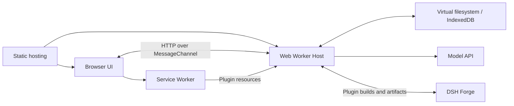

# DeepSeek Harness AIB

[English](README.md) | 中文

## 概述

**AIB — All in Browser** 将 DeepSeek Harness 的智能体运行时带入浏览器。在一个页面里进行对话、调用工具、操作虚拟文件，并构建插件来扩展智能体能力和界面。

项目的目标是让浏览器成为使用和扩展智能体框架的工作区。Host 运行在 Web Worker 中，文件保存在虚拟文件系统里，**dsh-aib** 工作台负责管理源码项目、插件版本和备份。模型推理通过外部 API 完成；可选的 [DSH Forge](https://github.com/li-chx/dsh-aib-forge.git) 负责构建插件源码和准备 npm 包。

这是一个独立的实验性 [DeepSeek Harness 分支](https://github.com/deepseek-ai/deepseek-harness)，上游项目由 DeepSeek AI 开发。浏览器兼容性和 API 仍在持续演进。

## 目录

- [为什么选择 AIB？](#why-aib)
- [演示与 API Key](#demo-and-api-key)
- [项目目标](#project-goals)
- [技术设计](#how-it-works)
- [运行浏览器预览](#run-the-browser-preview)
- [当前限制](#current-limitations)
- [开发](#development)
- [上游与许可证](#upstream-and-license)

<a id="why-aib"></a>
## 为什么选择 AIB？

将智能体框架及其能力放进浏览器，必然会遇到诸多限制。可用工具、网络访问和整体使用体验都会比原生环境更受限。AIB 接受这些取舍，是因为这种架构仍然有两项实际收益：

1. **方便分发开箱即用的插件能力组。** 部署者可以将一组插件打包分发，使用者打开页面即可使用，无需自行部署 Harness 后端。如果嵌入环境自行实现通过 RPC 代发 HTTP 请求，并在浏览器网络限制之外完成请求，还可以避开浏览器施加的 CORS 限制，让更多能力便于分发。这部分代发实现需要另行提供。
2. **以近乎零运行时运维成本分发 Harness。** 静态服务器分发应用，每位用户的设备运行自己的 Harness 实例。在需要隔离用户及其插件的服务端托管模式中，每位用户都需要独立执行环境，例如容器。AIB 省去了服务端为每位用户创建和维护这些环境的成本。

如果 DeepSeek 官方推出 Android DSH 客户端，社区也能规范插件分发方式，提供开箱即用的插件整合包，AIB 就会失去这些分发优势。这是正常且值得欢迎的结果。

**AIB 并非零后端。** 安装或编译新插件仍然需要已部署的 DSH Forge 服务。Forge 是不承载用户运行状态的无状态构建后端：它可以保留构建产物与缓存，但不托管用户的 Session 或长期运行的 Harness 实例。即使没有 Forge，已打包的应用及其内置能力仍可正常使用，只是无法安装和编译插件。模型推理仍通过外部 API 完成。

<a id="demo-and-api-key"></a>
## 演示与 API Key

计划中的演示地址：[https://dsh-aiw.lichx.top](https://dsh-aiw.lichx.top)（待部署）。

演示不预置公共 API Key，需要自行填写临时 Key。默认直连模型 API 时，Key 保存在浏览器本地，仅随鉴权请求发送给所配置的模型提供商，不提交给演示站点服务器或 Forge 后端。自定义代理和第三方插件需要自行信任；请勿把 Key 写入提交给 Forge 编译的源码。**推荐体验结束后立即在模型提供商控制台撤销或删除临时 Key。**

<a id="project-goals"></a>
## 项目目标

- **让智能体与界面一起运行在浏览器里。** 静态服务器提供前端资源，浏览器承载插件树、配置和 Session 生命周期。
- **让用户和智能体能够扩展工作区。** 创建 Host 和 Client 插件，通过 Forge 构建，再由 Cordis 热替换生效。
- **刷新后保留工作成果。** 将工作区文件、配置、Session 和已安装插件保存到浏览器存储，并将选定文件与插件版本导出为备份。

<a id="how-it-works"></a>
## 技术设计

浏览器承载应用运行时。静态服务器分发初始应用和文件系统镜像；模型 API 与 Forge 分别提供推理和构建服务。



- **复用 Harness 插件架构。** Cordis 用插件组合 Host。Node 兼容层基于浏览器能力提供文件系统、流、模块加载及部分进程 API，使受支持的 Harness 包可以在 Worker 中运行。
- **将运行时打包为文件系统镜像。** VFS 打包器收集已构建的包，并将可达模块转换为 Worker 加载器支持的形式。Client 分块按需从独立归档加载，Worker 内不携带 TypeScript 编译器。
- **将浏览器资源请求桥接到 Host。** Service Worker 将同源插件请求，包括 `<script src="…">`、图片和音频，转发给发起请求的标签页所属的 Worker，避免动态资源落到静态服务器后返回 404。生成的资源目录确保前端静态资源仍由静态服务器提供。
- **运行中构建和替换插件。** Forge 编译声明的 Host JS/TS 与 Client JS/JSX/TS/TSX 源码。浏览器校验收到的产物，将其安装到 VFS，再通过 HMR 生效。Client 构建复用页面的共享模块，包括 React。
- **在工作台管理文件和版本。** dsh-aib 页面提供编辑器、源码项目构建、插件历史版本、有限命令和备份导入导出。IndexedDB 在插件树启动前恢复已保存的数据。
- **允许替换出站 HTTP 实现。** 模型调用、Forge 请求和受支持的插件 HTTP 操作共用实例持有的传输实现。默认使用浏览器 Fetch，嵌入环境可以提供其他实现。

详细行为见 [Worker 运行时](packages/experimental/webworker-runtime/README.zh.md)、[VFS 打包器](packages/experimental/webworker-packer/README.zh.md)和[工作台](packages/experimental/client-ui-aiw/README.zh.md)。

<a id="run-the-browser-preview"></a>
## 运行浏览器预览

在[本仓库](https://github.com/li-chx/deepseek-harness-all-in-browser)的源码目录中，使用 Node.js `^22.19.0 || >=24.0.0` 和 `package.json` 声明的 pnpm 版本。Node 与 pnpm 用于准备部署产物，构建后的 Host 由浏览器运行。

```sh
pnpm install --frozen-lockfile
pnpm run build
pnpm --filter @deepseek-ai/dsh-web-frontend run build:preview
pnpm --filter @deepseek-ai/dsh-web-frontend run serve:preview
```

打开[本地预览](http://localhost:4173/?preview-fixture=none&storage=indexeddb)。站点根路径会携带原有 URL 参数跳转到 `preview.html`；该链接不加载示例数据，并启用 IndexedDB 持久化。预览需要 HTTPS 或 localhost/回环地址，以便 Service Worker 接管页面。部署时请完整发布 `apps/web/dist/` 目录，包括资源桥接脚本、静态资源目录和 VFS 归档。

部署到 EO 或其他静态平台时，使用 Node.js 24 和以下配置。`build:preview` 会生成跳转到 `preview.html` 的 `index.html`，保留查询参数和 hash，访问者可以直接打开部署站点的根地址。

| 部署配置 | 值 |
|---|---|
| 根目录 | `./`（仓库根目录） |
| 安装命令 | `pnpm install --frozen-lockfile` |
| 构建命令 | `pnpm run build:artifacts && pnpm --filter @deepseek-ai/dsh-web-frontend run build:preview` |
| 输出目录 | `apps/web/dist` |

在前端的**构建进程**中设置以下公开环境变量，即可让部署站点的根地址使用你的默认配置：

| 环境变量 | 对应 URL 参数 | 可用值 |
|---|---|---|
| `DSH_CLIENT_PREVIEW_FIXTURE` | `preview-fixture` | `none` 表示空环境，也可指定已构建目录中的 fixture ID。 |
| `DSH_CLIENT_FORGE_URL` | `forge` | 兼容 Forge 服务的绝对 HTTP(S) 地址。 |
| `DSH_CLIENT_STORAGE` | `storage` | `indexeddb` 启用持久化，`none` 使用临时运行时。 |

```sh
DSH_CLIENT_PREVIEW_FIXTURE=none \
DSH_CLIENT_FORGE_URL=https://forge-dsh-aib.lichx.top \
DSH_CLIENT_STORAGE=indexeddb \
pnpm --filter @deepseek-ai/dsh-web-frontend run build:preview
```

显式 URL 参数优先于对应的构建默认值，包括空参数。环境变量为空或未设置时，保留原有启动行为。浏览器已保存的 Forge 地址优先于这两种初始地址。这些值会写入公开的 JavaScript；构建完成后再修改静态服务器的环境变量不会生效，更换默认值需要重新构建。构建默认值不会作为配置参数自动追加到浏览器地址栏。

在侧栏打开 **dsh-aib**，管理文件和插件项目。**保存文件**将编辑草稿写入 VFS；**构建项目**通过 Forge 编译已保存的源码；**立即保存**排空 Session 待写入数据并确认浏览器存储提交。刷新或关闭页面前请先保存。

如需构建或安装插件，请运行兼容的 Forge 服务，并在工作台的「设置」中配置服务地址。Forge 必须匹配前端的代际标识和共享包版本。编辑文件、浏览保留的历史版本不需要 Forge。插件构建与安装方式见 [Forge 集成参考](packages/experimental/webworker-runtime/README.zh.md#forge-plugin-updates)。

模型请求需要提供商凭据和可访问的模型 API。公开部署时，请勿将私人凭据放入静态镜像。上游 npm CLI 和 `pnpm dsh web` 启动的是 Node Host；本文介绍的浏览器运行时请使用上面的浏览器预览构建方式。

<a id="current-limitations"></a>
## 当前限制

- 兼容层实现部分 Node API。Worker 内无法使用原生可执行文件、任意操作系统进程或通用 Node/npm 工具链，命令行提供的是有限的虚拟 shell。
- 浏览器 Fetch 遵循 CORS 规则。将 Host 放入 Worker 不会获得浏览器拒绝的网络权限，模型推理仍需要可访问的提供商服务。
- Forge 是外部构建服务。编译成功不代表 Host 激活成功，也不代表 Client 界面行为符合预期；更新后需要实际验证。
- 浏览器存储属于当前站点和浏览器。清除站点数据会删除已保存的内容，存储配额与回收规则仍然适用。备份覆盖选定文件或插件版本，不是完整的运行中 Session/配置档案恢复。
- 插件作为应用代码执行，可以使用其运行时提供的能力。兼容层不提供对不可信 JavaScript 的安全隔离，运行插件前请阅读[安全说明](SAFETY.zh.md)。

<a id="development"></a>
## 开发

先阅读[开发指南](docs/development.zh.md)和[架构文档](docs/architecture.zh.md)，再通过上面的包参考了解浏览器专属实现。[上游文档](https://deepseek-harness.github.io/deepseek-harness/)介绍共用的 Harness 概念与 Node 工作流。

<a id="run"></a>

<a id="run-from-source"></a>

仓库保留的 Node 教程在安装依赖、完成仓库构建后，使用 [CLI 源码执行流程](apps/cli/reference/README.zh.md#source-execution)。该流程运行 Node Host，操作电脑的文件系统；AIB 请使用上面的浏览器预览入口。

参与贡献请遵循 [CONTRIBUTING.md](CONTRIBUTING.zh.md)。编码智能体请阅读 [AGENTS.md](AGENTS.md)。

<a id="upstream-and-license"></a>
## 上游与许可证

AIB 基于 [DeepSeek Harness](https://github.com/deepseek-ai/deepseek-harness) 和 [Cordis](https://github.com/cordiverse/cordis) 构建。原项目的 Harness 架构、智能体能力和共享 UI 是本项目的基础。

[MIT](LICENSE)。第三方许可证见 [THIRD_PARTY_NOTICES.md](THIRD_PARTY_NOTICES.md)。
